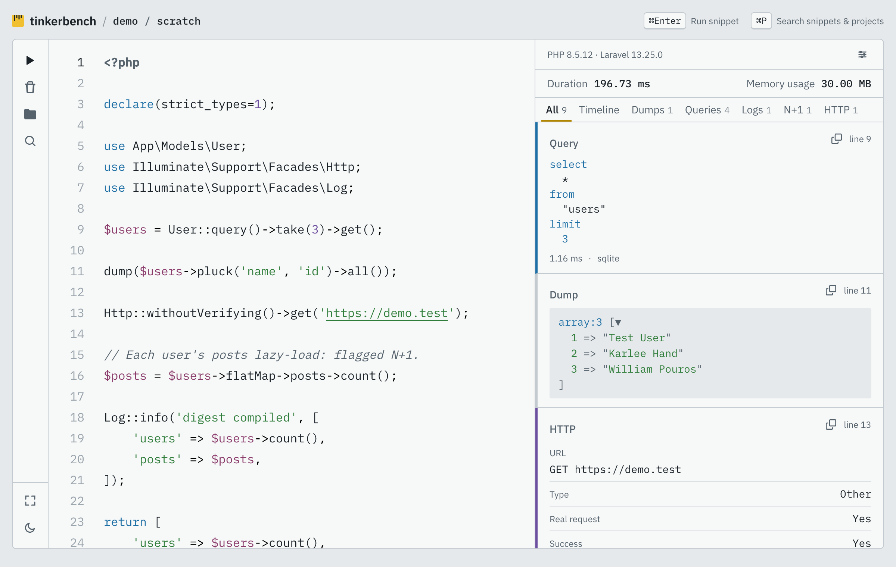

# tinkerbench



[](https://github.com/moessimple/tinkerbench/actions/workflows/tests.yml)
[](https://github.com/moessimple/tinkerbench/actions/workflows/lint.yml)
[](https://github.com/moessimple/tinkerbench/actions/workflows/static.yml)

tinkerbench is a browser-based REPL for any project linked in [Laravel Herd](https://herd.laravel.com).
Write a PHP snippet, run it against that project's own runtime, and see the output immediately, no separate setup per project.
A take on Laravel's [`tinker`](https://github.com/laravel/tinker), inspired by [Tinkerwell](https://tinkerwell.app).

> [!WARNING]
> tinkerbench runs the PHP you type inside your projects' real runtimes, with their databases and services attached. Keep it on your own machine. It's a personal dev tool, not something to deploy or expose.

## Features

* Any Herd-linked project as a target, switchable without leaving the page.
* Multiple named snippets per project. Create, rename, and delete them as needed.
* Command palette (`⌘P`) to jump between snippets and projects, similar to an editor's quick open.
* An editor with PHP syntax highlighting, autosave, and a run shortcut (`⌘Enter`).
* PHP autocompletion, hover documentation, and signature help for the target project's own code.
* A single chronological feed of everything a run touched, each entry its own card in execution order. Every project gets dumps, return values, exceptions, and standard output. A Laravel 12 or newer project also gets database queries, log entries, N+1 warnings, outgoing HTTP requests (including each redirect), and optional view-rendering traces.
* Filter the feed by kind with live counts, and click a card to jump the editor to the line that produced it.
* Output rendering adapts to the value: `dump()`/`dd()` use Symfony's interactive VarDumper, JSON is syntax highlighted, and HTML renders in a sandboxed frame.
* Query cards pretty-print their SQL and flag it when slow (100 ms or more) or repeated. The Queries tab sums up the query count, duplicates, and total query time, and sorts slowest first when you need to.
* The duration and memory usage of a run sit above the feed. The Timeline tab splits the snippet's own time into database, HTTP, and code time, so you can see where a slow run spends its time. Booting is how long your project takes to start, so it runs higher than in a web request.
* Every card has a button to copy its contents.
* Light and dark theme, switchable from the sidebar, following your system preference by default.

## Requirements

* [Laravel Herd](https://herd.laravel.com) with PHP 8.5 and Composer 2.11 or newer and npm 11.17 or newer available. Herd bundles PHP, Composer, and Node.
* Target projects need PHP 8.2 or newer. Pin a project's PHP version with `herd isolate` if needed.
* The database query, log entry, N+1 warning, HTTP request, and view-rendering cards need a Laravel 12 or newer target. Every other PHP project still produces dumps, return values, exceptions, and standard output.

## Installation

Clone the repository and run the setup script:

```bash
git clone https://github.com/moessimple/tinkerbench.git
cd tinkerbench
composer setup
```

`composer setup` installs the dependencies, creates `.env`, migrates the database, downloads a headless Chromium for the browser tests, builds the frontend, and links the site to Herd at [`http://tinkerbench.test`](http://tinkerbench.test) on PHP 8.5.

## Usage

Open [`http://tinkerbench.test`](http://tinkerbench.test). It opens the `scratch` snippet in the `tinkerbench` project. Press `⌘P` and type `/` to run against one of your own Herd projects instead.

* Write PHP in the editor and run it with the play button or `⌘Enter`.
* In the command palette (`⌘P`): `/` switches project, `#` searches snippets, and a name that doesn't exist yet creates a snippet.
* For Laravel projects, use the Watchers menu above the output feed to switch individual watchers on or off. View-rendering traces are off by default. The settings are remembered per project.
* Clear the output or maximize the editor from the sidebar icons.

## Staying Up to Date

Pull the latest changes and rerun the setup script to bring dependencies and migrations back in sync:

```bash
git pull
composer setup
```

## Dependency updates

Composer and npm wait three days before accepting new releases. Dependabot applies
the same cooldown to regular version updates. Its security updates bypass that
wait, but Composer and npm still enforce their own cooldowns.
Existing lockfiles remain installable. For a critical security fix, review the
maintainer advisory and bypass the cooldown only for that update:

```bash
composer update --no-cooldown vendor/package
npm update package-name --min-release-age-exclude=package-name
```

Review the complete dependency diff: Composer bypasses the cooldown for the whole
command, including newly resolved dependencies. Advisory and malware blocking and
Vet trust checks remain active.

`composer test:audit` checks both `composer.lock` files and `package-lock.json` for known CVEs on demand. Dependabot alerts report new advisories for the lockfiles.

## Testing

Run the full quality gate (composer.json validation, formatting, type coverage, static analysis, and the PHP, JS, runner, and browser test suites):

```bash
composer test
```

## License

The MIT License (MIT). Please see [License File](LICENSE.md) for more information.
